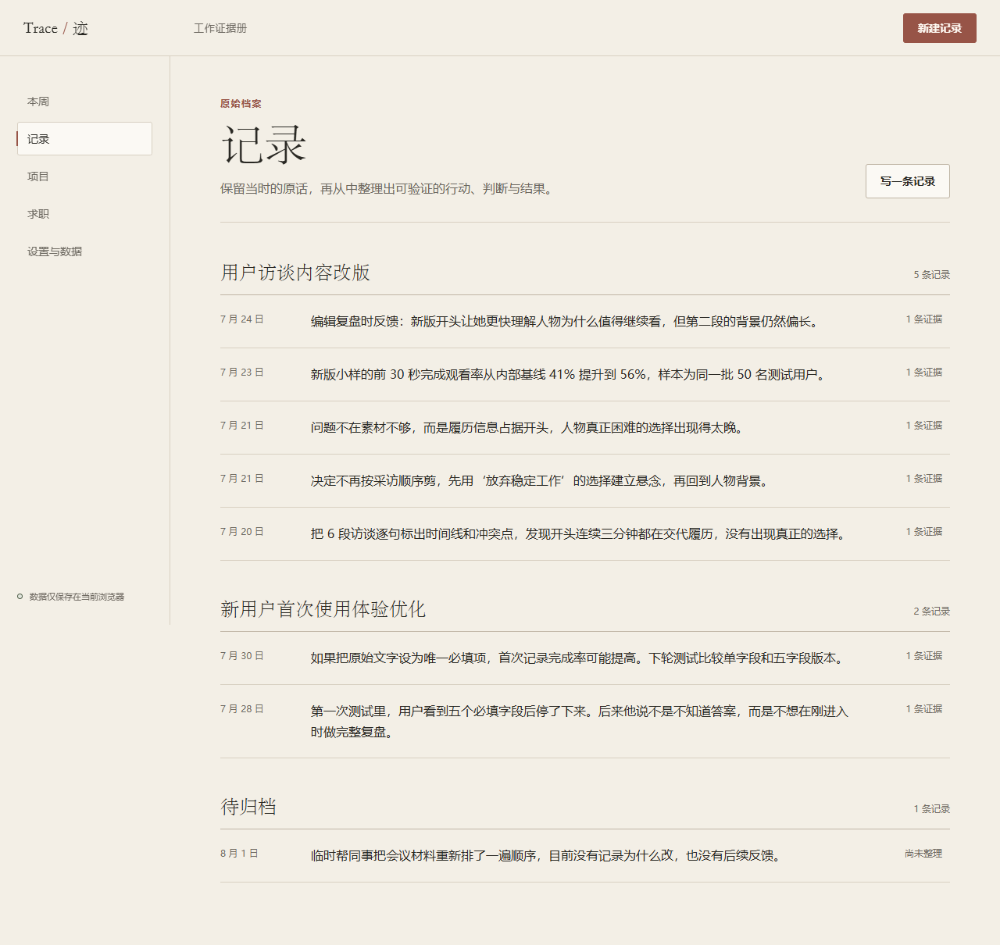
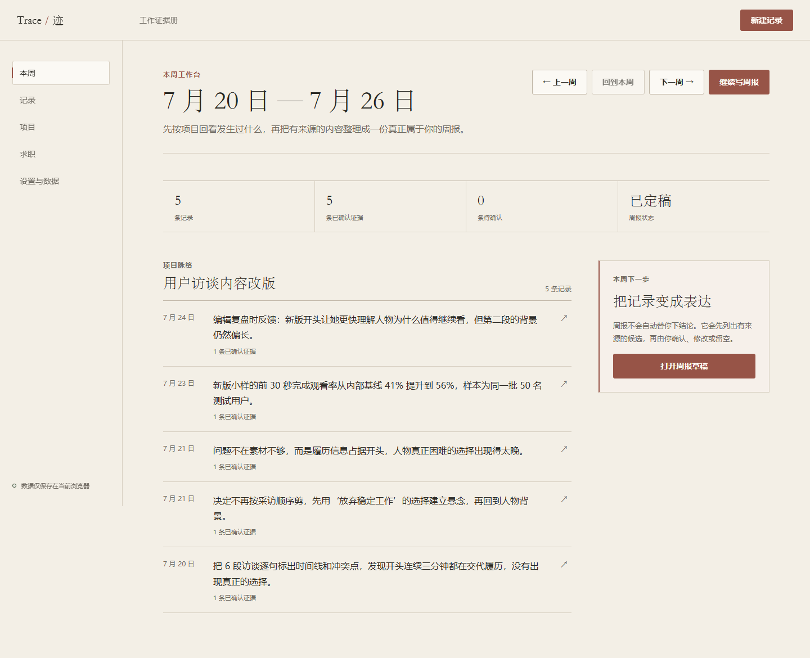
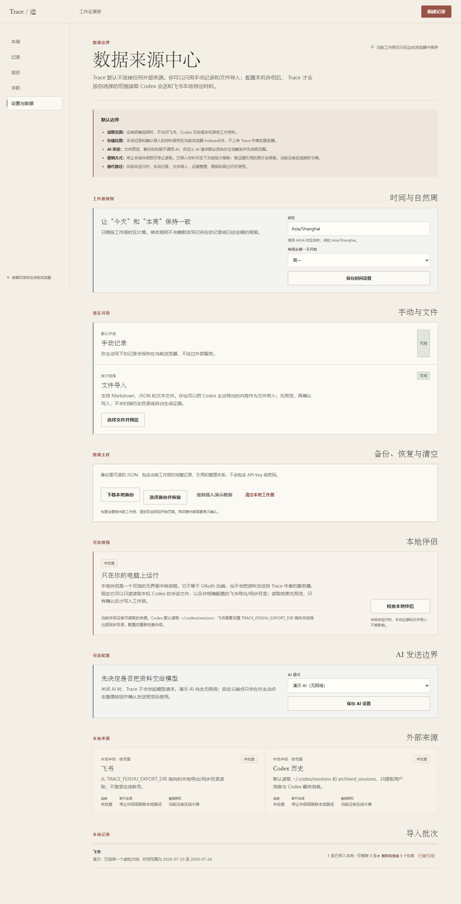
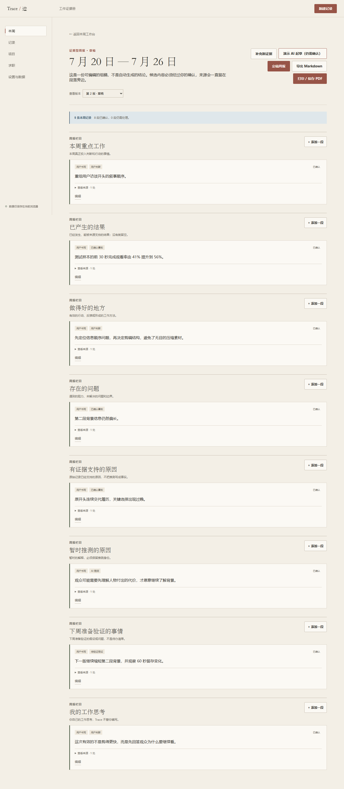
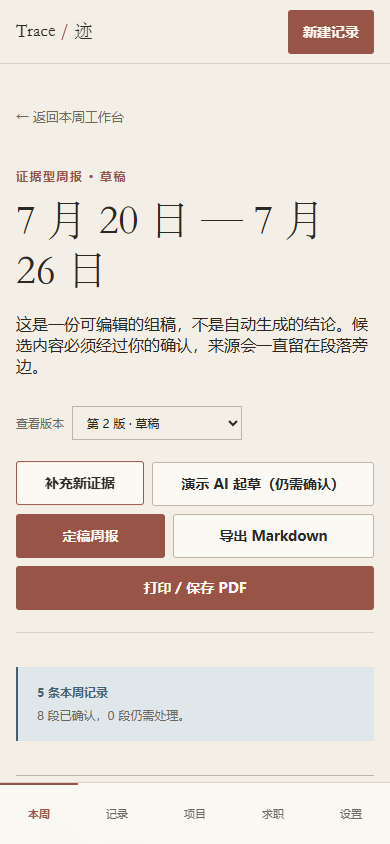
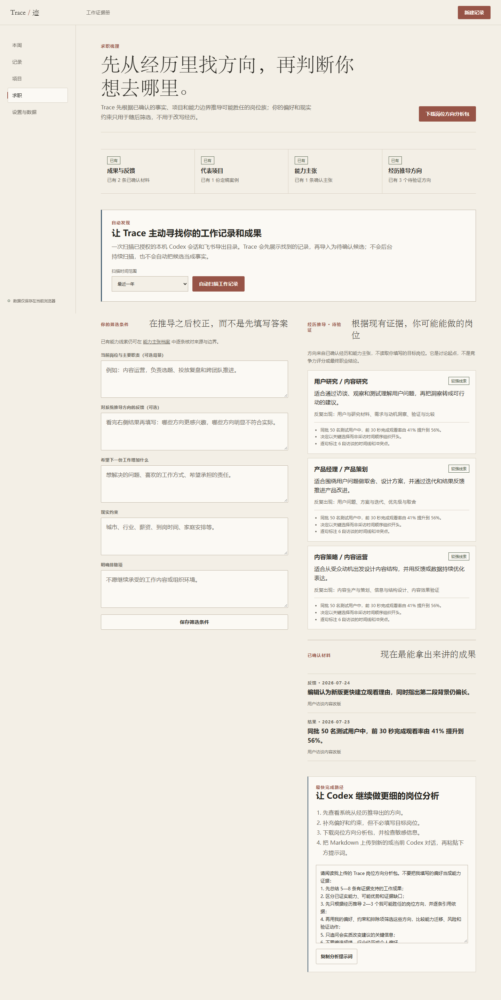

<div style="font-family: SimHei, 'Microsoft YaHei', sans-serif;">

# Trace / 迹

> 把每天散落的工作痕迹，沉淀为经得起回看、验证和表达的个人工作证据。

Trace 是本地优先的工作证据册，服务于不易持续记录和总结的运营、产品、市场、项目管理与内容工作者。它帮助用户说清做过什么、为什么这样做、结果从哪里来，再把这些材料用于周报、项目案例和能力表达。

## 使用流程

记录或导入工作材料 → 整理带引用的证据候选 → 用户修改和确认 → 组装周报或项目案例 → 导出 Markdown / 打印为 PDF。

当前版本 0.3.0 支持：

- 原始记录、修订历史、七类证据和来源引用；
- 按周、按项目回看，周报与案例逐块确认、定稿、修订和导出；
- 从已定稿案例沉淀单项目能力主张；
- Markdown、JSON、文本导入，以及完整工作册备份、恢复和清空；
- 本地伴侣读取 Codex 会话和配置的飞书本地导出目录；
- 求职梳理：主动发现本机材料中的成果候选，从已确认经历推导可能的岗位族；
- 无网络演示 AI，以及可选的自定义 AI 端点。

飞书在线授权、后台同步、图片附件解析和跨项目能力自动聚合尚未实现。没有 AI 配置时，手动记录、整理、编辑和导出仍可使用。

## 产品原则

- 结论保留来源；事实、判断、推测和假设分别标注。
- AI 输出先成为候选，用户可以确认、修改或拒绝；确认推测不会把它变成事实。
- 不虚构成绩、数据或反馈，不用证据数量评分。
- 关注工作判断与过程，保持个人档案感，不扩展为任务管理或企业后台。

## 本地运行

需要 Node.js 20.19+ 或兼容的新版本。首次运行：

```sh
npm ci
npm run start:local
```

打开 [Trace 本地入口](http://127.0.0.1:4173/records)。保持启动进程运行；关机或停止进程后，再次启动才能访问。

Codex 默认检测当前用户的 `.codex/sessions` 与 `archived_sessions`。飞书需要先导出或同步资料到本地，再配置目录并启动。PowerShell 示例：

```powershell
$env:TRACE_FEISHU_EXPORT_DIR = 'D:\path\to\feishu-export'
npm run start:local
```

Windows 桌面快捷方式可指向 `scripts/launch-desktop.ps1`：它复用已运行服务，缺失时在后台启动，并用默认浏览器打开。该入口会检测工作区旁的 `feishu_exports` 目录作为本地来源；显式环境变量优先。更多格式、范围和配置见[本地伴侣说明](./companion/README.md)。

## 数据与 AI

工作册保存在当前浏览器的 IndexedDB；不同浏览器、隐身窗口和不同端口可能使用不同的工作册。请固定浏览器和 4173 地址，并在设置页定期下载 JSON 备份。清理浏览器数据或设备故障可能导致丢失。

本地伴侣只读取配置范围内的 Codex 会话或飞书本地材料，不连接在线飞书、不读取 Codex 凭证。导入经过预览和确认；证据草稿仍需用户审核。自定义 AI 端点在用户确认发送范围后接收任务输入，认证、限流和留存由端点负责；Trace 不保存 API Key。演示数据完全虚构。

详见[隐私说明](./PRIVACY.md)、[来源边界](./docs/DATA_SOURCES.md)与[安全说明](./SECURITY.md)。自定义 AI 协议以 `src/infrastructure/ai/customEndpointAiAdapter.ts` 和 [ADR-017](./docs/decisions/ADR-017-custom-ai-endpoint-boundary.md) 为准。

## 界面预览

以下截图均使用虚构演示工作册。








## 开发与验证

React + TypeScript + Vite；IndexedDB 使用 Dexie。领域规则、数据仓库、AI 适配器和导出与界面分层。

```sh
npm run format:check
npm run lint
npm run typecheck
npm test
npm run build
```

端到端测试使用已安装的 Google Chrome，并包含 Firefox 和移动视口。首次运行需安装测试浏览器：

```sh
npx playwright install firefox
npm run test:e2e
```

## 项目文档

- [产品简报](./PRODUCT_BRIEF.md) · [设计原则](./DESIGN_PRINCIPLES.md) · [数据模型](./DATA_MODEL.md)
- [验收标准](./ACCEPTANCE_CRITERIA.md) · [开发计划](./DEVELOPMENT_PLAN.md) · [协作约束](./AGENTS.md)
- [关键产品决策](./docs/decisions/) · [状态与视觉验收](./docs/STATE_STORIES.md) · [版本记录](./CHANGELOG.md)

采用 [MIT License](./LICENSE)，版权主体为 `Trace / 迹 contributors`。

</div>
